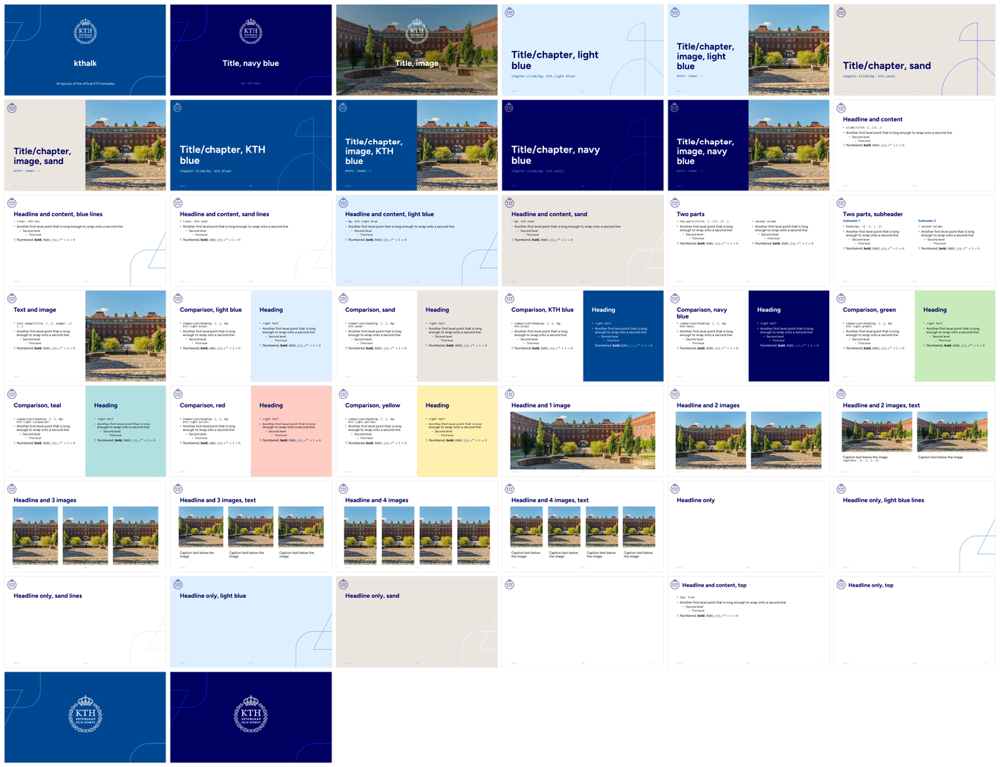

# kthalk

Unofficial replica of the [KTH Royal Institute of Technology](https://www.kth.se) PowerPoint template (version 2025-12-03).
It has the same layouts, colours, font, logo and line art, with positions and sizes taken from the official `.potx` file.



## Setup

On macOS, install Typst and the presenter app [pdfpc](https://pdfpc.github.io) with [Homebrew](https://brew.sh):

```sh
brew install typst pdfpc
```

Install the static Figtree font files (the Font section below explains why not the Homebrew font package):

```sh
cd ~/Library/Fonts && for s in Regular Bold Italic BoldItalic; do curl -fLO "https://raw.githubusercontent.com/erikdkennedy/figtree/master/fonts/ttf/Figtree-$s.ttf"; done; cd -
```

## Usage

Start a new presentation from the template:

```sh
typst init @preview/kthalk:0.1.0
```

In the web app, choose *Start from template* and search for `kthalk`.
Or import the package into an existing file:

```typ
#import "@preview/kthalk:0.1.0": *

#show: kthalk.with(
  title: [My talk],
  subtitle: [Name Surname, Department, KTH],
  date: datetime.today(),
  slide-numbers: true,
)

#title-slide()

#chapter-slide(title: [Introduction])

#slide(title: [Headline])[
  - First level
    - Second level
]

#logo-slide()
```

[`docs/layouts.typ`](docs/layouts.typ) shows every layout of the official template, with the call that produces it.

## Font

The template uses [Figtree](https://fonts.google.com/specimen/Figtree) (SIL Open Font License).
Typst packages cannot ship fonts, so install it yourself.
Use the **static** font files (`Figtree-Regular.ttf`, `Figtree-Bold.ttf`, …), which you can download from the [`fonts` folder of this package's repository](https://github.com/t-sorger/kthalk/tree/main/fonts) or from the [Figtree repository](https://github.com/erikdkennedy/figtree/tree/master/fonts/ttf).
Typst only uses the default weight of a variable font (`Figtree[wght].ttf`), which for Figtree is Light, so text would come out too thin and without bold.

- **Command line:** install the static files on your system, or put them in a folder of your project and compile with `typst compile --font-path fonts main.typ`.
- **Web app:** upload the static `.ttf` files into your project.

Without Figtree, Typst falls back to its default font and shows a warning.

## Configuration

Settings for the whole presentation go in the `kthalk` show rule, once at the top.
The slides pick them up automatically.

| Parameter       | Default | Description                                                                                                       |
| --------------- | ------- | ----------------------------------------------------------------------------------------------------------------- |
| `title`         | `none`  | Title on the title slide, footer text and PDF title.                                                              |
| `subtitle`      | `none`  | Subtitle on the title slide.                                                                                      |
| `footer`        | `auto`  | Footer centre: `auto` uses `title` and `none` hides it.                                                           |
| `date`          | `none`  | Footer left: a `datetime` (shown as YYYY-MM-DD) or any content.                                                   |
| `slide-numbers` | `false` | Slide number in the footer right.                                                                                 |
| `bg`            | `(:)`   | Default backgrounds per slide type: a dictionary with any of `title`, `chapter`, `slide`, `comparison` and `end`. |
| `lines`         | `auto`  | Default line art for `slide` (see below).                                                                         |
| `lang`          | `"en"`  | Text language.                                                                                                    |
| `..args`        |         | Touying settings, e.g. `config-common(handout: true)` (see below).                                                |

For example, a navy presentation:

```typ
#show: kthalk.with(
  title: [My talk],
  bg: (title: kth.navy, chapter: kth.navy, comparison: kth.navy),
)
```

The end slide uses the title slide's colour unless `end` is set.
Only backgrounds that the official template has a layout for are accepted.
Anything else stops with an error that lists the allowed colours.

## Slides

Every `bg: auto` uses the default from the show rule.
Pass a colour to override it for one slide.

| Function                                                            | Official layouts                              | `bg`                                                                                                                                  |
| ------------------------------------------------------------------- | --------------------------------------------- | ------------------------------------------------------------------------------------------------------------------------------------- |
| `title-slide(title: auto, subtitle: auto, bg: auto)`                | Title                                         | `kth.blue`, `kth.navy` or an image, e.g. `kth-campus`                                                                                 |
| `chapter-slide(title: none, subtitle: none, bg: auto, photo: none)` | Title/chapter, with or without image          | `kth.light-blue`, `kth.sand`, `kth.blue`, `kth.navy`                                                                                  |
| `slide(title: none, bg: auto, lines: auto, top: false)[body]`       | Headline and content, Headline only, Empty    | `white`, `kth.light-blue`, `kth.sand`                                                                                                 |
| `two-parts(title: none, headings: none)[left][right]`               | Two parts, with or without subheaders         |                                                                                                                                       |
| `text-image(title: none, photo)[body]`                              | Text and image                                |                                                                                                                                       |
| `comparison(title: none, heading: none, bg: auto)[left][right]`     | Comparison                                    | `kth.light-blue`, `kth.sand`, `kth.blue`, `kth.navy`, `kth.light-green`, `kth.light-turquoise`, `kth.light-brick`, `kth.light-yellow` |
| `image-slide(title: none, captions: none, ..images)`                | Headline and 1–4 images, with or without text |                                                                                                                                       |
| `logo-slide(bg: auto)`                                              | Logo                                          | `kth.blue`, `kth.navy`                                                                                                                |

- `title-slide` takes its title and subtitle from the show rule unless you pass them.
- `slide(lines: ..)` adds line art in the bottom right: `none`, `kth.sky`, `kth.sand` or `white`.
  With `auto`, light blue and sand slides get the line art of the official layouts.
- `slide(top: true)` puts the headline next to the logo, which leaves more room for content.
- `two-parts(headings: ([..], [..]))` adds a subheader above each column.
- Images are passed as content, e.g. `image("photo.jpg")`, and are cropped to fill their area.
- `kth-campus` is the KTH campus photo from the official "Title, image" layout.
  `#title-slide(bg: kth-campus)` gives that slide.
  It works anywhere an image is expected.
- Every slide function also takes `notes: [..]` for speaker notes (see below).

Lists follow the official template: bullets in KTH blue and text sizes of 20, 18, 16, 14 and 12 pt for nested levels.

## Colours

The `kth` dictionary contains the KTH colour palette: `kth.blue`, `kth.navy`, `kth.sky`, `kth.light-blue`, `kth.sand` and `kth.digital-blue`, plus `green`, `turquoise`, `brick`, `yellow` and `grey`, each also with a `dark-` and a `light-` variant (e.g. `kth.dark-brick`, `kth.light-green`).

## Animations and speaker notes

Animations and speaker notes come from [Touying](https://typst.app/universe/package/touying), and kthalk re-exports the parts you need.

```typ
#slide(title: [Results], notes: [Mention the sample size.])[
  - Shown first
  #pause
  - Appears on the next click
  #pause
  - And then this
]
```

- `#pause` splits a slide into steps, which all keep the same slide number.
- `#meanwhile` makes the following content start again at the first step.
- `#uncover("2-")[..]`, `#only(3)[..]`, `#alternatives[..][..]` and `#item-by-item[..]` show content on chosen steps.
- In two-column slides, the steps run through the left column first and then through the right one.
- `notes: [..]` shows the note on every step of the slide.
- Inside a slide body, `#speaker-note[..]` works too and shows the note from the step where it is written.

To present with notes, export them for [pdfpc](https://pdfpc.github.io) and open the PDF in it:

```sh
typst compile main.typ
typst eval 'query(<pdfpc-file>).first().value' --in main.typ > main.pdfpc
pdfpc main.pdf
```

Two more settings go in the show rule:

- `config-common(show-notes-on-second-screen: right)` puts the notes next to each slide on a double-width page, for presenter apps that split pages, e.g. `pdfpc --notes=right main.pdf`.
- `config-common(handout: true)` turns off the animations and gives one page per slide, e.g. for a PDF to share.

```typ
#show: kthalk.with(title: [My talk], config-common(handout: true))
```

For a one-off handout without editing the file, compile with `--input handout=true`:

```sh
typst compile --input handout=true main.typ handout.pdf
```

## License

This project is licensed under the [MIT License](LICENSE-MIT), except for the contents of the `template/` directory (the files you edit in your own presentation), which are licensed under [MIT No Attribution](LICENSE-MIT-0).

SPDX-License-Identifier: MIT AND MIT-0

Not covered by these licenses:

- The KTH logo, the KTH graphic elements and the campus photo (`campus.jpg`) in `src/assets/`, and the images that show them (`thumbnail.png`, `docs/overview.png`).
  They belong to KTH Royal Institute of Technology, and the use of the logo is governed by KTH's [brand rules (Varumärkesregler)](https://intra.kth.se/polopoly_fs/1.1479111.1780051667!/Varumarkesregler.pdf), in Swedish.
  Check them before using the logo or the photo.
- The Figtree fonts in the repository's `fonts/` folder, which are licensed under the [SIL Open Font License 1.1](https://github.com/t-sorger/kthalk/blob/main/fonts/OFL.txt).

This is not an official KTH product and is not endorsed by KTH.
